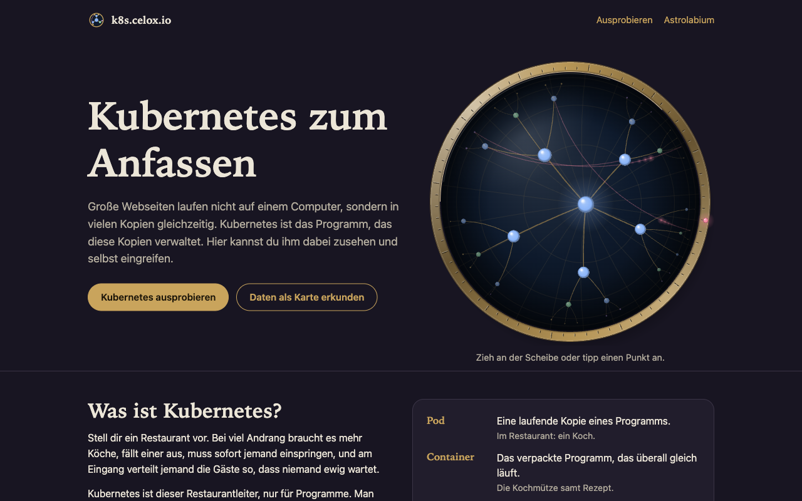
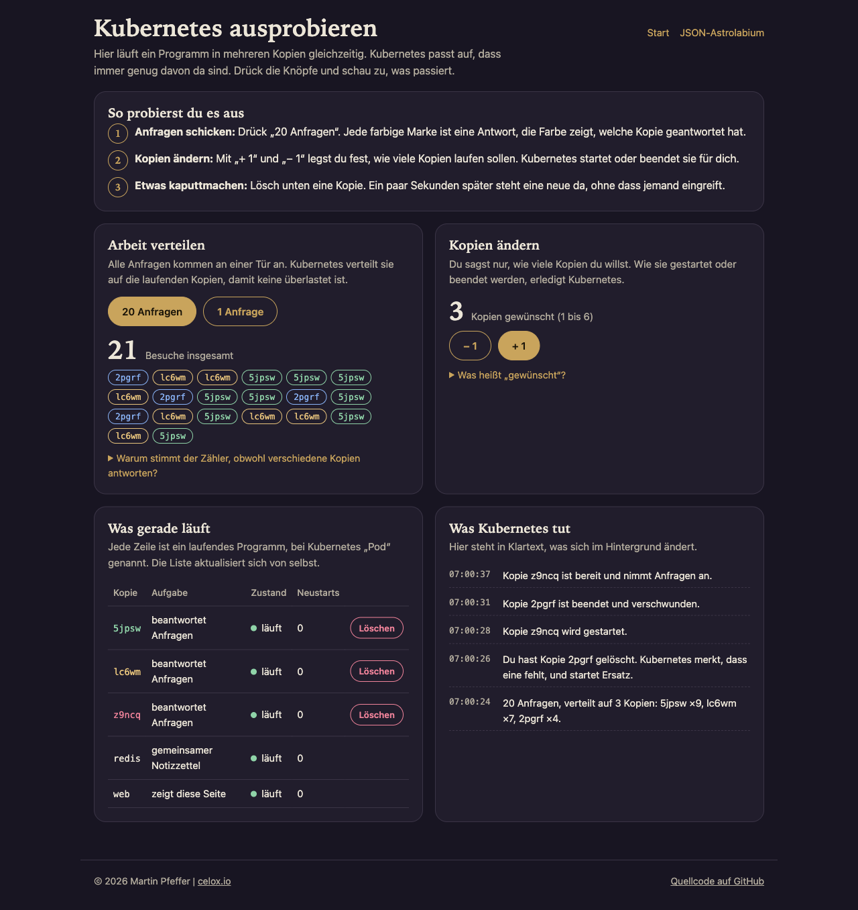
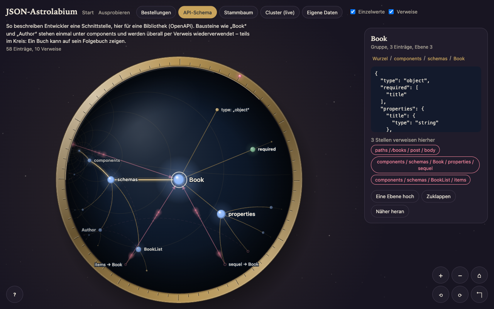

# k8s-showcase

<p>
  <a href="https://k8s.celox.io"></a>
  <a href="LICENSE"></a>
  <a href="https://github.com/pepperonas/k8s-showcase/commits/main"></a>
  
</p>
<p>
  
  
  
  
  
</p>
<p>
  
  
  
  
  
  
  
</p>

Zwei kleine Vorführungen zum Ausprobieren, live unter **[k8s.celox.io](https://k8s.celox.io)**. Die Startseite erklärt alles ohne Vorwissen; von dort geht es weiter:

1. **Kubernetes ausprobieren** (`/cluster.html`): Man sieht, wie ein Programm auf mehrere Kopien verteilt wird, wie man es per Knopfdruck vergrößert und wie es sich selbst repariert, wenn man eine Kopie „abschießt“.
2. **JSON-Astrolabium** (`/tree.html`): Datenstrukturen als drehbare Landkarte, in der man mit Maus oder Finger herumfliegt.



## Inhalt

- [Was ist Kubernetes, ganz kurz?](#was-ist-kubernetes-ganz-kurz)
- [Kubernetes zum Anfassen: was man sieht](#kubernetes-zum-anfassen-was-man-sieht)
- [JSON-Astrolabium: was man sieht](#json-astrolabium-was-man-sieht)
- [Kann das den Server lahmlegen?](#kann-das-den-server-lahmlegen)
- [Selbst starten](#selbst-starten)
- [Wie es gebaut ist](#wie-es-gebaut-ist)
- [Auf dem Server](#auf-dem-server)
- [Aufbau des Repos](#aufbau-des-repos)

## Was ist Kubernetes, ganz kurz?

Stell dir ein Restaurant vor. Die Küche ist ein Programm, die Gäste sind Anfragen aus dem Internet. Bei viel Andrang stellt man mehr Köche ein; fällt ein Koch aus, springt sofort ein neuer ein; und am Eingang verteilt jemand die Gäste so, dass kein Koch überlastet ist.

**Kubernetes ist dieser Restaurantleiter für Programme.** Man sagt ihm nur, *was* man haben will – „drei Kopien dieses Programms, bitte“ –, und er sorgt dauerhaft dafür, dass es genau so bleibt. Die einzelnen Kopien heißen **Pods**. Jeder Pod ist ein kleines, abgeschlossenes Paket (ein **Container**), das überall gleich läuft.

## Kubernetes zum Anfassen: was man sieht



Hinter der Seite laufen drei Programme, die zusammenarbeiten:

- **web** zeigt die Seite an, die du im Browser siehst,
- **api** beantwortet die Anfragen – davon laufen gleich **drei Kopien** nebeneinander,
- **redis** ist ein kleiner gemeinsamer Notizzettel, auf dem der Besuchszähler steht.

Drei Dinge kann man ausprobieren:

| Knopf | Was passiert | Was es zeigt |
|---|---|---|
| **20 Requests** | 20 Anfragen gehen raus; jede farbige Marke zeigt, welche Kopie geantwortet hat | Die Arbeit wird **automatisch verteilt**. Der Zähler stimmt trotzdem, weil alle Kopien denselben Notizzettel benutzen. |
| **+ 1 / − 1** | Es laufen mehr oder weniger Kopien | **Skalieren**: Kubernetes startet neue Kopien oder räumt welche weg, ohne dass die Seite ausfällt. |
| **Kill** | Eine Kopie wird gelöscht | **Selbstheilung**: Nach wenigen Sekunden steht eine neue Kopie an ihrer Stelle, weil Kubernetes merkt, dass eine fehlt. |

Die Liste „Was gerade läuft“ zeigt in Echtzeit, welche Kopien laufen, starten oder verschwinden. Daneben schreibt „Was Kubernetes tut“ in Klartext mit, was passiert, etwa: „Du hast Kopie cfq2m gelöscht. Kubernetes merkt, dass eine fehlt, und startet Ersatz.“ – „Kopie xgmd2 ist bereit und nimmt Anfragen an.“

## JSON-Astrolabium: was man sieht



**JSON** ist das Format, in dem Programme sich gegenseitig Daten schicken: eine Bestellung mit Kunde, Adresse und Artikeln zum Beispiel. Solche Daten sind wie ein Baum verzweigt. Oft zeigt eine Stelle auf eine andere („diese Bestellung gehört zu *diesem* Kunden“) – das sind **Verweise** (`$ref`).

Das Astrolabium zeichnet so einen Baum auf eine runde Scheibe. Das Besondere: Die Scheibe ist eine **hyperbolische Ebene**, wie in den Kreisbildern von M. C. Escher. Zur Mitte hin ist alles groß, zum Rand hin wird es immer kleiner, aber es hat trotzdem alles Platz – egal wie tief der Baum ist. Was einen interessiert, holt man einfach in die Mitte.

- **Punkte** sind Einträge: blau für Gruppen, grün für Listen, die kleinen bunten für einzelne Werte, hohle Ringe für Verweise.
- **Linien** zeigen, was wozu gehört. Sie sind gebogen, weil das in dieser Geometrie der kürzeste Weg ist.
- **Gestrichelte Pfeile** sind Verweise. **Rot** heißt: Der Verweis zeigt ins Leere.

So bewegst du dich:

| Was du willst | Maus / Trackpad | Handy / Tablet | Tastatur |
|---|---|---|---|
| Herumschieben | Ziehen (gleitet nach) | Wischen | Pfeiltasten |
| Einen Punkt in die Mitte holen | Anklicken | Antippen | `[` `]` Nachbarn, Rücktaste eine Ebene hoch |
| Näher heran / weiter weg | Mausrad, Doppelklick | Zwei Finger auseinander, Doppeltippen | `+` `−` |
| Drehen | Am Messingring ziehen oder mit rechter Maustaste ziehen | Zwei Finger drehen | `Q` `E` |
| Zurück zum Anfang | ⌂ | ⌂ | `0` |

Wenn ein Punkt in die Mitte fährt, dreht sich die Karte so, dass das, wo er herkommt, links liegt. Man liest also immer von links nach rechts tiefer hinein. Rechts (am Handy unten) steht, was in dem Eintrag drinsteht und wer auf ihn verweist; ein Klick auf einen Verweis fliegt direkt dorthin.

Zum Ausprobieren gibt es fünf Datensätze; unter den Knöpfen steht jeweils, was man sieht:

| Knopf | Was es ist | Worauf achten |
|---|---|---|
| **Bestellungen** | ein kleiner Online-Shop: Kunden, Adressen, Produkte, drei Bestellungen | Bestellungen verweisen auf Kunden und Produkte, statt sie zu kopieren; ein Verweis zeigt absichtlich ins Leere (rot) |
| **API-Schema** | die Beschreibung einer Programmier-Schnittstelle für eine Bibliothek (OpenAPI) | Bausteine wie „Book“ werden einmal definiert und überall wiederverwendet, teils im Kreis |
| **Stammbaum** | eine Familie über drei Generationen | Verweise quer durch den Baum: Ehepartner, Pate, Mentorin |
| **Cluster (live)** | die laufende Kubernetes-Vorführung, frisch abgefragt | Pod → ReplicaSet → Deployment, Service → Pods |
| **Eigene Daten** | beliebiges eigenes JSON | Verweise mit `{"$ref": "#/pfad"}` |

**Darstellung:** Die Scheibe ist als Glaskugel in Messingfassung gerendert (Licht von oben links, Randvignette als Tiefe, Spiegelung), dahinter Sternenstaub. Ein hyperbolisches Gitter verzerrt sich beim Ziehen mit der Ebene. Knoten sind beleuchtete Kugeln, der Pfad zur Auswahl leuchtet, über aktive Verweise wandern Lichter – in hyperbolisch gleichmäßigem Tempo, also zum Rand hin scheinbar langsamer. Beim Laden faltet sich der Baum aus der Mitte auf, beim Auf- und Zuklappen gleiten Zweige auf Geodäten, eine Auswahl sendet eine Welle aus. Bei „Bewegung reduzieren“ entfallen alle Animationen. Gemessen: 119–121 Bilder pro Sekunde bei Kamerafahrten.

## Kann das den Server lahmlegen?

Kurz: nein, dafür ist gesorgt. Die Vorführung läuft auf demselben Server wie andere Webseiten. Weil jeder Besucher Programme löschen und vervielfachen darf, ist sie in drei Schichten eingezäunt:

| Schicht | Was sie begrenzt | Wie |
|---|---|---|
| **Ganzer Cluster** | höchstens **1 von 4 CPU-Kernen** und **1,2 GB RAM** | Docker-Grenze am k3d-Container (`docker update --cpus 1 --memory 1200m`), bleibt über Neustarts erhalten |
| **Jede Kopie** | api 0,2 Kerne / 64 MB, Redis und nginx 0,1 Kerne / 64 bzw. 32 MB, höchstens 6 api-Kopien | Kubernetes-`resources.limits`, Obergrenze im API-Code |
| **Zugang** | je Adresse: 10 Abrufe/s, 20 Änderungen/min, 30 Live-Bäume/min, 20 gleichzeitige Verbindungen; **über alle Adressen zusammen**: 40 Abrufe/s, 2 Änderungen/s, 3 Live-Bäume/s | nginx `limit_req`/`limit_conn`, Antwort 429 „kurz warten“ |

Gemessen im Leerlauf: rund 700 MB RAM und etwa 10 % eines Kerns. Unter Volllast ist bei einem Kern Schluss, die anderen drei bleiben für den Rest des Servers frei. Die Platte wächst nicht: es werden keine Daten gespeichert, die Logs sind auf 3 × 10 MB begrenzt.

**Was bleibt:** k3d braucht einen *privilegierten* Docker-Container. Wer aus dem Cluster ausbräche, hätte Rechte auf dem Server. Die Angriffsfläche ist klein (eigener Python-Code ohne Abhängigkeiten, Rechte nur im Namespace `demo`, Cluster und Kubernetes-API nur auf 127.0.0.1), aber nicht null. Wer das ausschließen will, betreibt die Vorführung auf einem eigenen kleinen Server.

## Selbst starten

Voraussetzungen: Docker läuft, `kubectl` und `k3d` sind installiert (Mac: `brew install k3d kubectl`).

```bash
./up.sh      # Cluster anlegen und alles starten -> http://localhost:8088
./down.sh    # alles wieder entfernen, der Speicherplatz ist danach frei
```

Das Astrolabium läuft auch ganz ohne Kubernetes: `k8s/web/` mit `python3 -m http.server` ausliefern und `tree.html` öffnen (dann ohne „Cluster (live)“).

## Wie es gebaut ist

Für alle, die es genauer wissen wollen.

```
Browser ──► nginx (web) ──/api/──► Service api ──► api-Pod ×3 (Python)
                                                     │           │
                                                     ▼           ▼
                                              Service redis   Kubernetes-API
```

| Deployment | Image | Kopien | Aufgabe |
|---|---|---|---|
| `web` | `nginx:alpine` | 1 | liefert die Seiten, leitet `/api/` an den Service `api` weiter |
| `api` | `python:3.12-alpine` | 3 (1–6) | Besuchszähler in Redis, Pod-Liste, Skalieren, Pod löschen, Namespace als `$ref`-Baum |
| `redis` | `redis:7-alpine` | 1 | gemeinsamer Zustand |

- **Klein gehalten:** keine eigenen Images (Code und Seiten kommen als ConfigMap in den Cluster), nur Alpine-Images, **k3s** statt eines vollen Kubernetes, keine Python-Abhängigkeiten (Redis per Socket, Kubernetes-API per `urllib`), Speicherlimits an jedem Container.
- **Rechte:** Die API spricht über einen ServiceAccount mit Kubernetes und darf nur im Namespace `demo`: Pods lesen und löschen (gelöscht werden nur `api-`-Pods), ausschließlich die Deployment `api` lesen und skalieren (1–6) sowie Deployments, ReplicaSets, Services, ConfigMaps und ServiceAccounts auflisten (für den Live-Baum). Von ConfigMaps gibt sie nur Dateinamen aus, nie den Inhalt.
- **Astrolabium:** Jede Bewegung ist eine Möbius-Transformation der Poincaré-Scheibe, Kanten sind Geodäten (Kreisbögen senkrecht zum Rand). Beim Layout bekommt jeder Unterbaum einen Winkelanteil seines Elternknotens; der Abstand zum Kind ist so gewählt, dass die Halbebene dahinter (Sichtwinkel = 2 × Winkel der Parallelität) in diesen Anteil passt – Unterbäume überlappen nie. Die Geometrie steckt in `k8s/web/hyper.js` und ist getestet: `node --test tests/hyper.test.mjs`.

## Auf dem Server

Live unter `k8s.celox.io`: Der k3d-Cluster läuft in Docker auf dem VPS und ist **nur an 127.0.0.1** gebunden (Seite auf `:4277`, Kubernetes-API auf `:6550`). nginx ist der einzige Weg hinein, drosselt (siehe [Kann das den Server lahmlegen?](#kann-das-den-server-lahmlegen)) und sendet strenge Sicherheits-Kopfzeilen. Die Docker-Grenzen setzt `up.sh`, wenn `CAP_CPUS`/`CAP_MEM` gesetzt sind; `deploy.sh` tut das automatisch. DNS und TLS kommen vom Wildcard-Eintrag `*.celox.io`. Die Seite ist nicht für Suchmaschinen freigegeben.

```bash
./deploy.sh setup   # einmalig: k3d + kubectl auf dem VPS, Cluster, nginx
./deploy.sh         # Code/Seiten aktualisieren
./deploy.sh nginx   # zusätzlich vHost + Kopfzeilen neu ausrollen
```

## Aufbau des Repos

```
up.sh / down.sh     Cluster starten bzw. entfernen
deploy.sh           Ausrollen nach k8s.celox.io
deploy/nginx/       vHost + Sicherheits-Kopfzeilen für den VPS
k8s/manifests.yaml  Namespace, Deployments, Services, Rechte
k8s/api.py          API (nur Python-Standardbibliothek)
k8s/nginx.conf      nginx im Cluster: Seiten + Weiterleitung auf /api/
k8s/web/            Seiten: index.html + landing.js (Start), cluster.html + app.js (Ausprobieren),
                    tree.html + tree.js (Astrolabium), hyper.js (Geometrie), orb.js (Darstellung der Scheibe),
                    site.css (gemeinsame Gestalt),
                    favicon.svg/-32.png, apple-touch-icon.png, og.jpg (Vorschaubild für soziale Netzwerke)
tools/              Vorlagen, aus denen Vorschaubild und Favicon-PNGs gerendert werden
tests/              Geometrie-Tests (node --test)
```

## Vorschaubild und Favicon neu erzeugen

Das Vorschaubild (`og.jpg`, 1200 × 630) zeichnet eine echte Poincaré-Scheibe mit derselben Geometrie wie das Astrolabium. Gerendert wird in Chrome, nicht mit ImageMagick (das kann Verläufe und Webschriften nicht sauber):

```bash
python3 -m http.server 8765 --bind 127.0.0.1   # im Repo-Ordner
# dann mit Playwright/Chrome:
#   tools/og.html     -> Element #og als JPEG  -> k8s/web/og.jpg
#   tools/icons.html  -> #c32 (transparent), #c180 -> favicon-32.png, apple-touch-icon.png
```

## Lizenz

[MIT](LICENSE) © 2026 Martin Pfeffer | [celox.io](https://celox.io)
